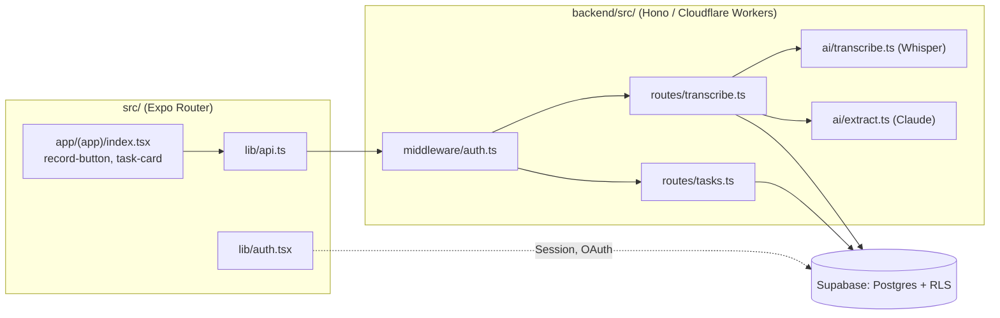

# Mapa projektu — Tellme

## TL;DR

Tellme to appka RN/Expo (frontend, Expo Router) + Cloudflare Worker na Hono (backend), połączone przez Supabase (auth + Postgres/RLS). Warstwy:

Skala jest mała (43 commity, ~3 miesiące, jeden autor, ~24 pliki `src/`, ~8 `backend/src/`), więc ta mapa nie udaje analizy Mattermost-scale — kalibrowana jest w dół (zero rozbicia kwartalnego, zero realnej mapy kontrybutorów), ale metoda jest ta sama: dowody z gita, grafu importów i kodu, nie zgadywanie. Praca skupiła się dotychczas na **auth** (pełny cykl `research→plan→implement`, własny change-id) i na **fundamencie testowym backendu**; **pipeline głos→zadanie — czyli faktyczny rdzeń produktu — nigdy nie przeszedł przez ten sam proces** i nie ma testów po żadnej stronie. To jest najważniejszy pojedynczy wniosek tej mapy.

## Teren

**Głębokie / centralne:**

- `src/lib/auth.tsx` (fan-in 6, 46 partnerów współzmian) — jedyny punkt dostępu do sesji w całej appce, przeszedł pełny cykl zmiany.
- `app/(app)/index.tsx` (fan-out 10, ~250 linii) — ekran główny robi naraz: nagrywanie, listę, wyszukiwanie, taby, optimistic update. To jest realne centrum lokalne UI, nie cienkie wejście.
- `backend/src/routes/transcribe.ts` (fan-out 4) — orkiestruje cały pipeline: transkrypcja → ekstrakcja → zapis. Najgrubszy plik backendu.
- `constants/theme.ts` / `hooks/use-theme.ts` (fan-in 11 / 9) — fundament UI, dotykany przez prawie wszystko, ale stabilny (theming, nie logika biznesowa).

**Płytkie / cienkie wejścia (świadomie, nie przez zaniedbanie):**

- `app/auth-callback.tsx` — celowo pusty `<Redirect href="/" />`, wymiana kodu OAuth dzieje się w `lib/auth.tsx`. Komentarz w pliku to potwierdza.
- `backend/src/ai/transcribe.ts`, `ai/extract.ts` — dobrze izolowane porty do Whisper/Claude, wywoływane tylko z jednego miejsca.

**Peryferia / martwe:** scaffold z `create-expo-app` (`animated-icon.tsx`, `ui/collapsible.tsx`, `app-tabs*.tsx`) — był w historii, **już usunięty z repo w całości**. Struktura katalogów dziś jest czystsza niż jej historia sugeruje; nie ma obecnie znanych martwych plików w `src/` lub `backend/src/`.

**Aktywność w czasie:** za krótka historia (3 miesiące) na sensowny podział kwartalny. Trzy klastry tematyczne widoczne w commitach: bootstrap → fundament testowy backendu → auth (z pełnym change-id) → ciągłe `fix(ci)` (najliczniejsza pojedyncza kategoria, 5 commitów). Pipeline głos→zadanie nie ma swojego klastra — zbudowany, ale nigdy nie wrócił do niego proces.

## Realne powiązania

- **`auth.tsx` ↔ `supabase.ts` ↔ ekrany logowania** — spójny klaster, potwierdzony i grafem importów, i współzmianami. Brak niespodzianek.
- **`TASK_STATUSES`/`TaskStatus` zduplikowane znak w znak** w `src/types.ts` i `backend/src/types.ts`, zero importu między nimi — _graf tego nie widzi_ (brak krawędzi), _współzmiany tego nie widzą_ (nigdy się razem nie zmieniły). To jest connascence znaczenia na dystansie, wykryte tylko przez ręczne czytanie obu plików. Pełna analiza: `context/domain/01-domain-distillation.md`.
- **Duplikacja logiki zapisu tasków**: `routes/transcribe.ts` (49–52) i `routes/tasks.ts` (54–57) mają niemal identyczny insert-blok. Kod, nie import — `madge` też tego nie złapie.
- **SDK-typ jako typ domenowy**: `src/lib/auth.tsx` wystawia `Session` z `@supabase/supabase-js` bezpośrednio jako `AuthState.session`. Kandydat ACL — `context/domain/03-anti-corruption-layer.md`.
- **Cykle:** brak, w obu grafach (`src/`, `backend/src/`).
- **Warstwy runtime, których graf nie widzi:** Cloudflare Workers AI binding (`c.env.AI`), zmienne środowiskowe Supabase/Anthropic — brak importu, ale realna zależność w runtime. Oznaczone jako `unknown` dla przyszłej zmiany w konfiguracji Workera.

## Strefy ryzyka

1. **Pipeline głos→zadanie bez testów po żadnej stronie.** Zero testów dla `src/lib/api.ts` (transcribe/fetchTasks/updateTask), `record-button.tsx`, `backend/src/routes/transcribe.ts`, `ai/transcribe.ts`, `ai/extract.ts`. To jedyny obszar appki, który realizuje główną propozycję wartości i jednocześnie ma najsłabszą siatkę bezpieczeństwa. **Dlaczego:** to jest cel L3 (Deep Focus) w tej ścieżce.
2. **Duplikacja insertu tasków między dwoma routerami** (`transcribe.ts` / `tasks.ts`) — nic nie pilnuje zgodności kształtu, jeśli jeden się zmieni bez drugiego.
3. **`TaskStatus` zduplikowany bez wspólnego źródła** — zmiana wartości statusu w jednym miejscu bez drugiego przejdzie każdy dotychczasowy test i CI.
4. **`RecordButton`: animacja świadomie wyłączona** (`// Reanimated temporarily removed to isolate an iOS-only freeze`) — udokumentowany, ale nie domknięty dług: przycisk nagrywania, czyli główny CTA appki, działa dziś bez animacji pulsu, bo naprawa zawieszenia na iOS nie została jeszcze zamknięta.
5. **`middleware/auth.ts` świadomie nie weryfikuje podpisu JWT** (deleguje do PostgREST, żeby zmieścić się w 10ms CPU cap free-tier Workera) — udokumentowana, świadoma decyzja, nie przypadkowy brak; wart guarda/testu potwierdzającego założenie („token bez ważnego JWT dostaje 401 na dalszym etapie"), nie przebudowy.
6. **`createSupabaseClient` oznaczony w kodzie jako `LOAD-BEARING`**, odsyła do `context/foundation/infrastructure.md` (risk register #1) — konkretny, już nazwany punkt kruchości infrastruktury, nie coś, co ta mapa odkrywa od zera.

## Kogo zapytać

Repo solo — nie ma kogo zapytać poza analizą dokumentów. Zamiast osób, per strefa:

| Strefa ryzyka                       | Gdzie szukać kontekstu                                                            |
| ----------------------------------- | --------------------------------------------------------------------------------- |
| Pipeline głos→zadanie               | `context/foundation/prd.md` (FR-004..FR-014), komentarze w `routes/transcribe.ts` |
| Auth / JWT                          | `context/changes/complete-auth-oauth-reset/` (change.md, plan.md, reviews/)       |
| Infrastruktura Supabase-na-Workerze | `context/foundation/infrastructure.md` (risk register)                            |
| Testy backendu                      | `context/changes/testing-backend-test-foundation/`                                |

## Pierwszy dzień

1. `context/foundation/prd.md` — co appka ma robić (FR-004..FR-014 to pipeline głos→zadanie).
2. `backend/src/routes/transcribe.ts` — orkiestrator rdzenia produktu, czyta się w 2 minuty i mówi więcej niż drzewo katalogów.
3. `src/app/(app)/index.tsx` — ekran główny, centrum UI.
4. `src/lib/auth.tsx` — jedyny punkt prawdy o sesji.
5. `backend/src/types.ts` + `src/types.ts` — przeczytać oba naraz, żeby zobaczyć duplikat `TaskStatus` na własne oczy.
6. `context/changes/complete-auth-oauth-reset/change.md` — jedyny w pełni udokumentowany cykl zmiany w projekcie, wzorzec do naśladowania.

## Ograniczenia

- **Okno czasowe:** cała historia gita (43 commitów, ~3 miesiące) — brak sensu w rozbiciu kwartalnym, więc go pominięto zamiast udawać trend.
- **Kontrybutorzy:** jeden autor pod dwiema tożsamościami gita — sekcja „kontrybutorzy" w tym repo jest z konieczności namiastką (pełne uzasadnienie: `artifact-3-contributors.md`).
- **Graf zależności** (`madge`) pokazuje importy statyczne w danym momencie, nie runtime coupling (Cloudflare bindings, zmienne środowiskowe) ani intencję. Zero cykli w obu grafach, ale to nie znaczy zero sprzężenia — patrz sekcja „Realne powiązania" dla sprzężeń, których graf nie widzi.
- **`dependency-cruiser` pominięty** na rzecz `npx madge` — nie dodano żadnej nowej zależności do `package.json`/`backend/package.json`.
- Ta mapa nie ocenia jakości kodu ani nie proponuje refaktoru — to robota L3/L4 (`context/changes/voice-task-pipeline/`, `context/changes/refactor-opportunities/`).
