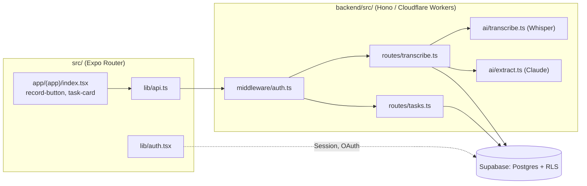

# Project map — Tellme

## TL;DR

Tellme is an RN/Expo app (frontend, Expo Router) + a Cloudflare Worker on Hono (backend), connected through Supabase (auth + Postgres/RLS). Layers:

The scale is small (43 commits, ~3 months, one author, ~24 files in `src/`, ~8 in `backend/src/`), so this map doesn't pretend to be a Mattermost-scale analysis — it's calibrated down (no quarterly breakdown, no real contributor map), but the method is the same: evidence from git, the import graph, and the code, not guesswork. Work so far has concentrated on **auth** (a full `research→plan→implement` cycle, its own change-id) and on the **backend's test foundation**; **the voice-to-task pipeline — the product's actual core — has never gone through that same process** and has no tests on either side. That's the single most important conclusion of this map.

## Territory

**Deep / central:**

- `src/lib/auth.tsx` (fan-in 6, 46 co-change partners) — the only access point to the session in the whole app, has been through a full change cycle.
- `app/(app)/index.tsx` (fan-out 10, ~250 lines) — the home screen does recording, the list, search, tabs, and optimistic updates all at once. A genuine local UI center, not a thin entry point.
- `backend/src/routes/transcribe.ts` (fan-out 4) — orchestrates the whole pipeline: transcription → extraction → save. The heaviest backend file.
- `constants/theme.ts` / `hooks/use-theme.ts` (fan-in 11 / 9) — the UI foundation, touched by nearly everything, but stable (theming, not business logic).

**Shallow / thin entry points (deliberately, not through neglect):**

- `app/auth-callback.tsx` — deliberately empty `<Redirect href="/" />`; the OAuth code exchange happens in `lib/auth.tsx`. A comment in the file confirms this.
- `backend/src/ai/transcribe.ts`, `ai/extract.ts` — well-isolated ports to Whisper/Claude, called from only one place.

**Periphery / dead:** `create-expo-app` scaffold (`animated-icon.tsx`, `ui/collapsible.tsx`, `app-tabs*.tsx`) — was in the history, **already removed from the repo entirely**. The directory structure today is cleaner than its history suggests; there are no currently known dead files in `src/` or `backend/src/`.

**Activity over time:** the history is too short (3 months) for a meaningful quarterly split. Three topical clusters are visible in the commits: bootstrap → backend test foundation → auth (with a full change-id) → ongoing `fix(ci)` (the largest single category, 5 commits). The voice-to-task pipeline has no cluster of its own — built, but the process never came back to it.

## Real couplings

- **`auth.tsx` ↔ `supabase.ts` ↔ sign-in screens** — a coherent cluster, confirmed both by the import graph and by co-changes. No surprises.
- **`TASK_STATUSES`/`TaskStatus` duplicated byte for byte** in `src/types.ts` and `backend/src/types.ts`, zero import between them — _the graph can't see this_ (no edge), _co-changes can't see this_ (they've never changed together). This is connascence of meaning at a distance, found only by reading both files by hand. Full analysis: `context/domain/01-domain-distillation.md`.
- **Task-save logic duplication**: `routes/transcribe.ts` (49–52) and `routes/tasks.ts` (54–57) have a near-identical insert block. Code, not an import — `madge` won't catch this either.
- **An SDK type used as a domain type**: `src/lib/auth.tsx` exposes `Session` from `@supabase/supabase-js` directly as `AuthState.session`. An ACL candidate — `context/domain/03-anti-corruption-layer.md`.
- **Cycles:** none, in either graph (`src/`, `backend/src/`).
- **Runtime layers the graph can't see:** the Cloudflare Workers AI binding (`c.env.AI`), Supabase/Anthropic environment variables — no import, but a real runtime dependency. Marked `unknown` for any future change to the Worker's configuration.

## Risk zones

1. **The voice-to-task pipeline has no tests on either side.** Zero tests for `src/lib/api.ts` (transcribe/fetchTasks/updateTask), `record-button.tsx`, `backend/src/routes/transcribe.ts`, `ai/transcribe.ts`, `ai/extract.ts`. The only area of the app that delivers the core value proposition, and simultaneously has the weakest safety net. **Why it matters:** this is the L3 (Deep Focus) target on this track.
2. **Task-insert duplication between two routers** (`transcribe.ts` / `tasks.ts`) — nothing enforces shape agreement if one changes without the other.
3. **`TaskStatus` duplicated with no shared source** — changing a status value in one place without the other would pass every existing test and CI.
4. **`RecordButton`: animation deliberately disabled** (`// Reanimated temporarily removed to isolate an iOS-only freeze`) — documented but unresolved debt: the record button, the app's main CTA, runs today without its pulse animation because the iOS freeze fix was never closed out.
5. **`middleware/auth.ts` deliberately doesn't verify the JWT signature** (delegates to PostgREST, to stay under the Worker free tier's 10ms CPU cap) — a documented, deliberate decision, not an accidental gap; worth a guard/test confirming the assumption ("a token without a valid JWT gets a 401 further downstream"), not a rebuild.
6. **`createSupabaseClient` is marked `LOAD-BEARING` in the code**, pointing at `context/foundation/infrastructure.md` (risk register #1) — a concrete, already-named point of infrastructure fragility, not something this map is discovering from scratch.

## Who to ask

Solo repo — there's no one to ask beyond analyzing the documents. Instead of people, per risk zone:

| Risk zone                         | Where to find context                                                            |
| --------------------------------- | -------------------------------------------------------------------------------- |
| Voice-to-task pipeline            | `context/foundation/prd.md` (FR-004..FR-014), comments in `routes/transcribe.ts` |
| Auth / JWT                        | `context/changes/complete-auth-oauth-reset/` (change.md, plan.md, reviews/)      |
| Supabase-on-Worker infrastructure | `context/foundation/infrastructure.md` (risk register)                           |
| Backend tests                     | `context/changes/testing-backend-test-foundation/`                               |

## Day one

1. `context/foundation/prd.md` — what the app is supposed to do (FR-004..FR-014 is the voice-to-task pipeline).
2. `backend/src/routes/transcribe.ts` — the product core's orchestrator, a 2-minute read that says more than the directory tree.
3. `src/app/(app)/index.tsx` — the home screen, the UI center.
4. `src/lib/auth.tsx` — the single source of truth for the session.
5. `backend/src/types.ts` + `src/types.ts` — read both at once to see the `TaskStatus` duplicate with your own eyes.
6. `context/changes/complete-auth-oauth-reset/change.md` — the only fully documented change cycle in the project, a pattern worth following.

## Limitations

- **Time window:** the whole git history (43 commits, ~3 months) — no point in a quarterly breakdown, so it was skipped rather than faking a trend.
- **Contributors:** one author under two git identities — the "contributors" section in this repo is necessarily a stand-in (full justification: `artifact-3-contributors.md`).
- **The dependency graph** (`madge`) shows static imports at a point in time, not runtime coupling (Cloudflare bindings, environment variables) or intent. Zero cycles in both graphs, but that doesn't mean zero coupling — see the "Real couplings" section for coupling the graph can't see.
- **`dependency-cruiser` was skipped** in favor of `npx madge` — no new dependency was added to `package.json`/`backend/package.json`.
- This map doesn't assess code quality or propose a refactor — that's L3/L4's job (`context/changes/voice-task-pipeline/`, `context/changes/refactor-opportunities/`).
